# ECE4810J Lab 1 Report

Getting Started with Arty Z7 SoC Development

Digilent Arty Z7-20  |  Fall 2026  |  Group 2  |  14 October 2026

| Name | Student ID |

| --- | --- |

| Yuan Haotong | 523370910163 |

| Zhao Tong | 523370910137 |

## 1 Overview

We built a basic Zynq system, added memory-mapped GPIO peripherals, and integrated custom multiplier and divider IP blocks. The Hello World program produced the expected UART messages. Four individual button tests showed the corresponding LEDs lit. The multiplier returned 6 for inputs 2 and 3, and the divider reported 11 board-level tests with zero failures. The divider simulation log additionally records 272 passing arithmetic cases and interface checks.

The four-step GPIO sequence is documented with board photographs, including simultaneous BTN2 and BTN3 presses with LD2 and LD3 lit, and release of all buttons with LD0 through LD3 unlit. The optional FIR filter exercise in Section 5 is not included.

## Environment

| Item | Configuration |

| --- | --- |

| Board and device | Arty Z7-20; xc7z020clg400-1 |

| Design tools | Vivado 2022.1 and Vitis 2022.1 on Windows |

| Software domain | Standalone application on ps7_cortexa9_0 |

| Serial connection | PuTTY; 115200 baud; 8 data bits; no parity; 1 stop bit; no flow control |

| Custom IP clock | 100 MHz for the implemented divider design |

## Report contents

| Part | Pages |

| --- | --- |

| Section 2  Basic Zynq system and Hello World | 2 |

| Section 3  GPIO design and board photographs | 3-5 |

| Section 4  Multiplier and divider design and verification | 6-10 |

| Section 6  Tcl exercises | 11 |

| Section 7  Post-lab questions and conclusions | 12 |

| Appendices  GPIO and divider application code | 13-14 |

# 2 Basic Zynq System

The Section 2 Vivado design configures the Zynq processing system using the Arty Z7-20 board preset and exposes DDR and fixed I/O. After generating the HDL wrapper and bitstream, the hardware is exported to Vitis. The standalone Hello World application initializes the platform, prints two messages through the PS UART, and then returns. [1]

Figure 1. Hello World application in the Vitis IDE with Build Finished visible.

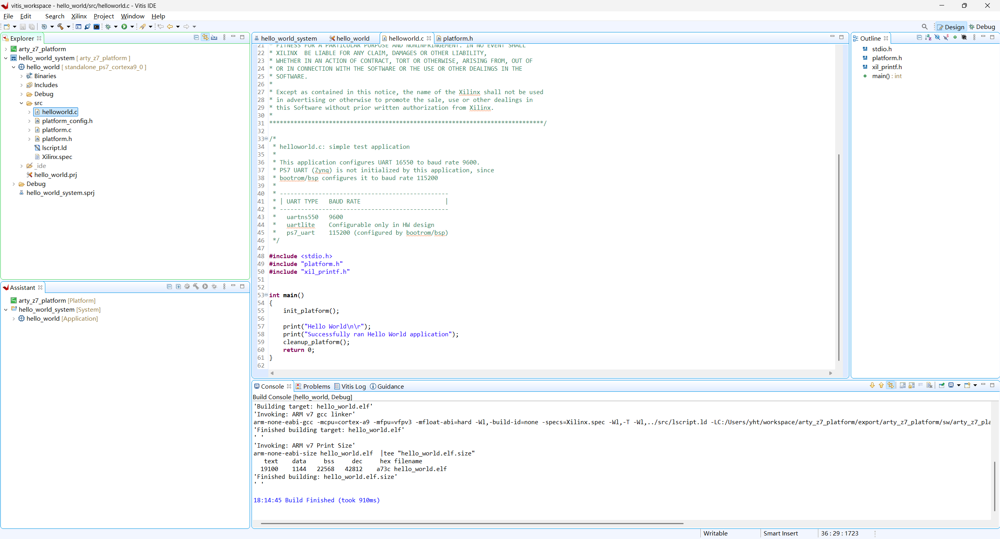

For autonomous startup, the SD boot image contains the FSBL, platform bitstream and hello_world.elf. The image is placed at the SD card root as BOOT.BIN. The captured COM10 UART output confirms that the application reaches both print statements.

Figure 2. Hello World UART output captured with PuTTY.

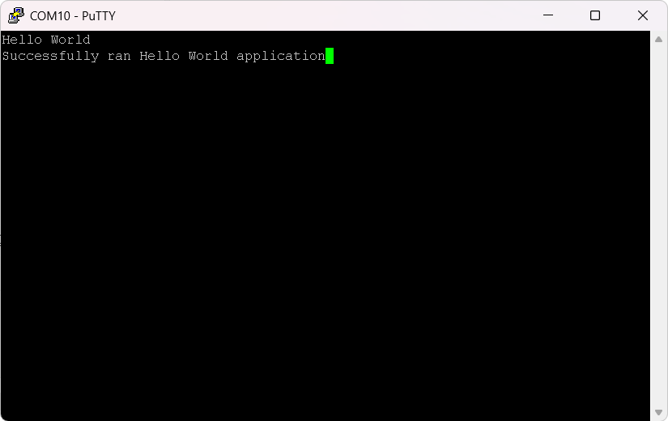

```text
Hello World
Successfully ran Hello World application
```

# 3 Zynq System with GPIO Peripherals

The PmodIPs design connects the PS M_AXI_GP0 port to an AXI interconnect and two AXI GPIO peripherals. axi_gpio_buttons has a 4-bit input interface at 0x41200000, and axi_gpio_led drives four LEDs at 0x41210000. The application initializes both devices, sets the button direction to 0xF and LED direction to 0x0, then repeatedly writes (button_data & 0xF) to the LEDs. The complete C program is included in Appendix A.

Figure 3. Implemented GPIO design. WNS = 3.135 ns; WHS = 0.094 ns; all user-specified timing constraints are met.

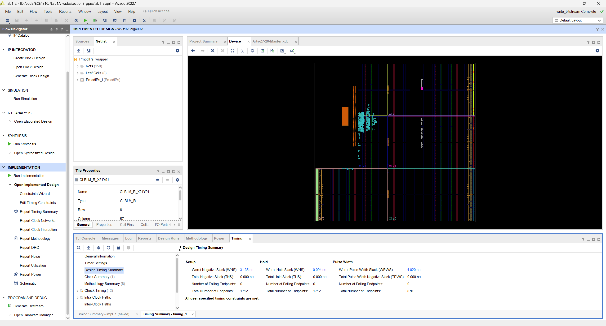

Figure 4. pmod_app compilation completed successfully in Vitis.

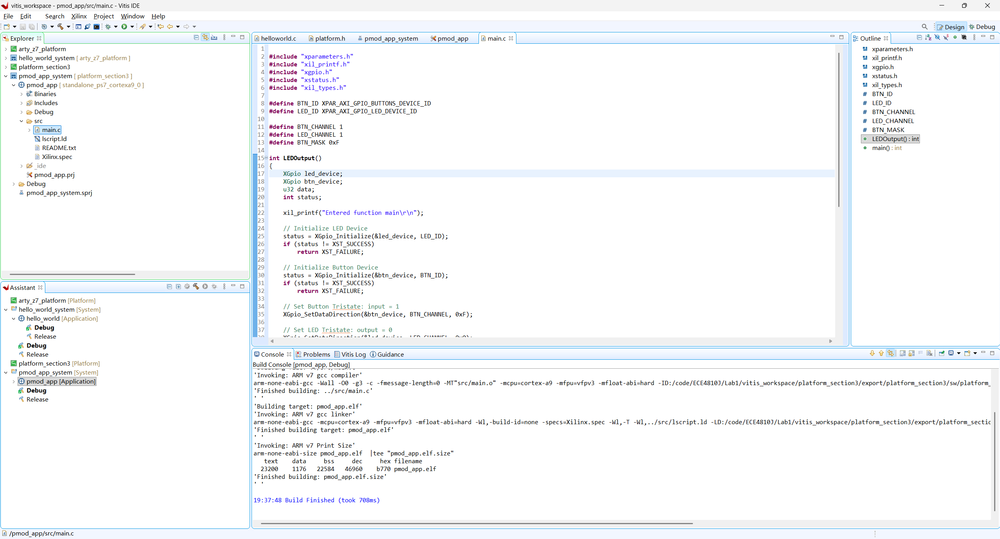

Positive setup and hold slack in Figure 3 show that the implemented design satisfies its specified timing constraints. They do not replace functional checks on the board. The loop copies all four input bits, so multiple LEDs can be asserted together; it also writes zero when all buttons are released.

# 3.1 Individual Button Checks

The four photographs show BTN0 through BTN3 pressed individually and the corresponding LD0 through LD3 lit. The other user LEDs are unlit in each photograph. These observations agree with the direct bit mapping implemented by the GPIO application.

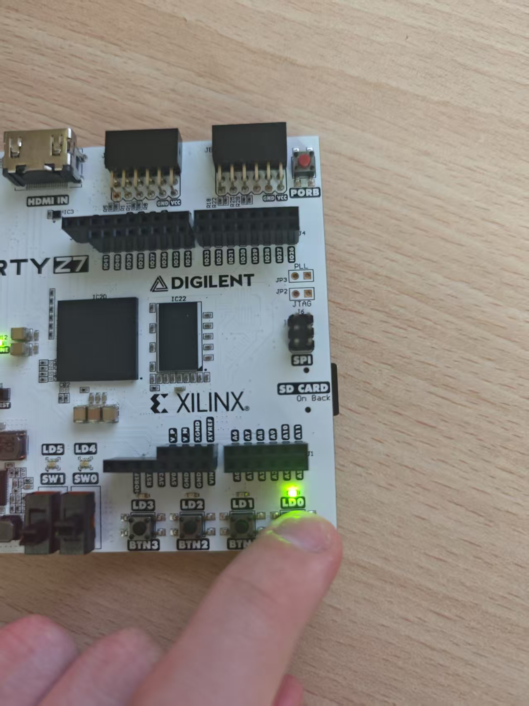

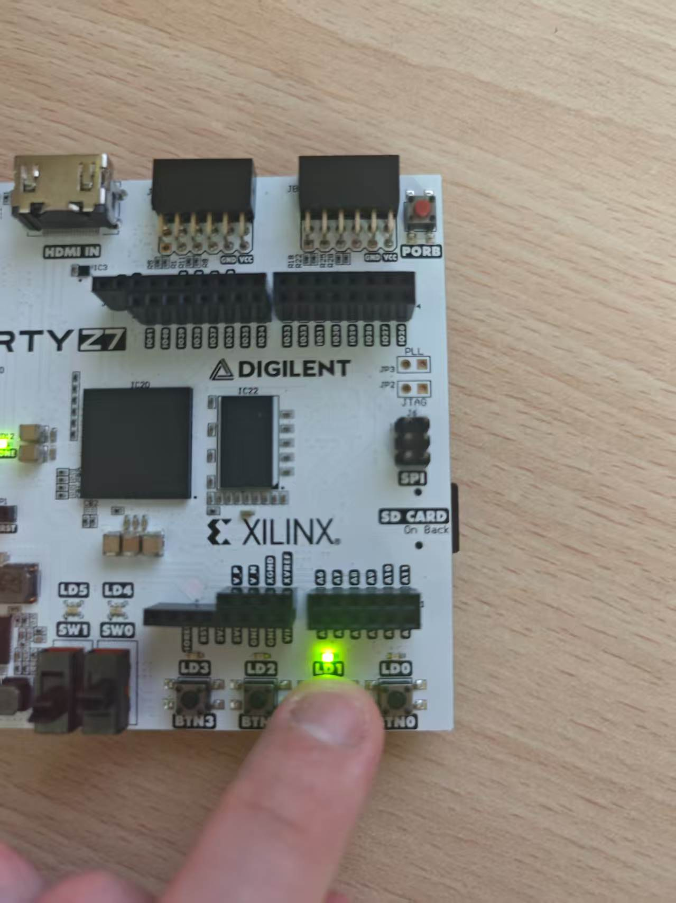

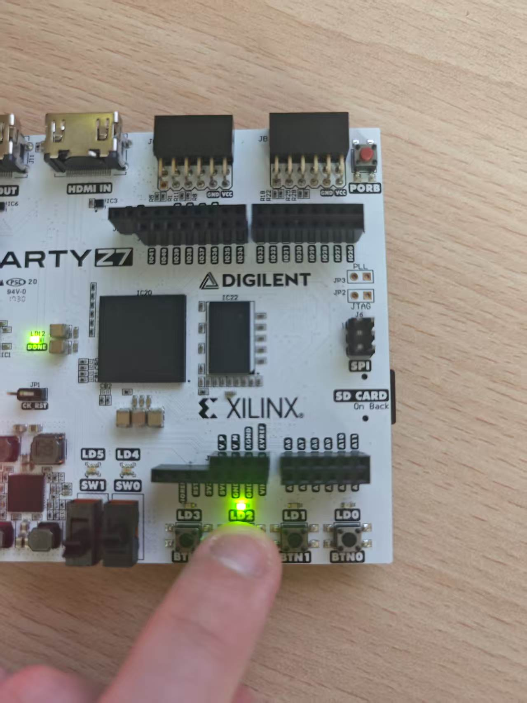

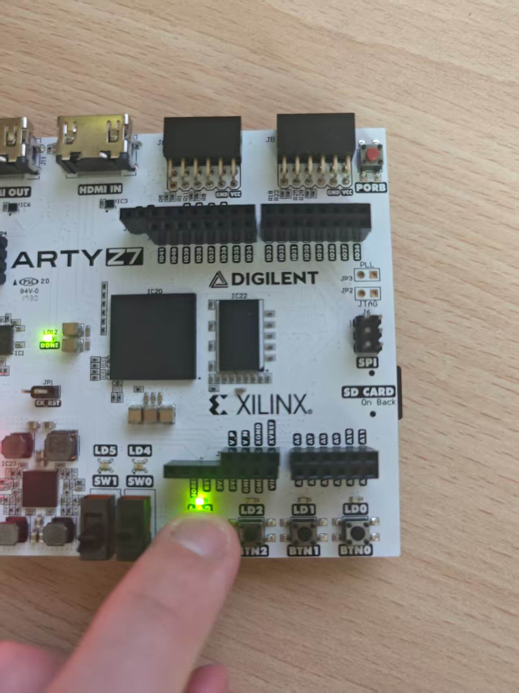

Figure 5. Individual button-to-LED correspondence on the Arty Z7-20.

These photographs verify each single-button mapping. The photographs on the next page also document the combined-button and all-released states.

# 3.2 Button Transition Sequence

The lab manual requests a four-step sequence: BTN3 pressed, BTN2 and BTN3 pressed together, BTN2 pressed alone, and all buttons released. [1, p. 17] The photographs below document all four states: LD3 lit, LD2 and LD3 lit together, LD2 lit alone, and all four user LEDs unlit, respectively.


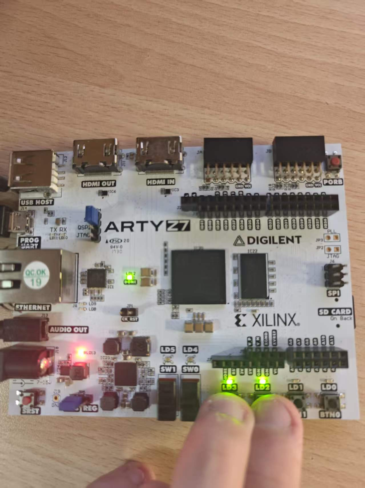


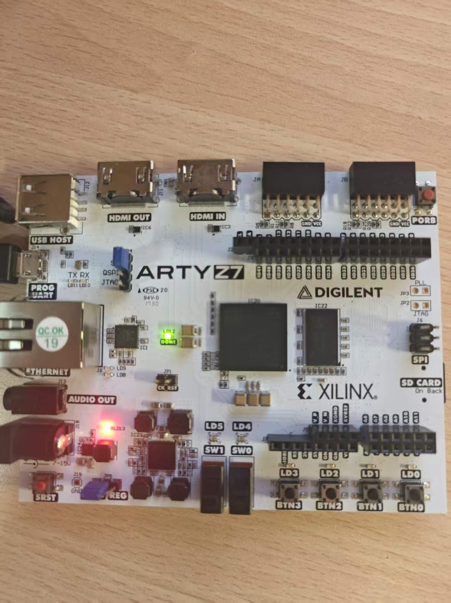

Figure 6. Board photographs documenting all four states of the GPIO sequence.

The software polls the raw GPIO level and contains no explicit debounce routine. The expected masks are 0x8, 0xC, 0x4 and 0x0, respectively. The photographs confirm simultaneous operation and that the user LEDs return to zero when all buttons are released.

# 4 Custom AXI IP Blocks

## 4.1 RTL multiplier design

The multiplier accepts two unsigned 16-bit operands and produces a registered 32-bit product. The AXI wrapper stores operand a in bits [31:16] and operand b in bits [15:0] of register 0. The read multiplexer returns the multiplier output at register 1. Both registers are accessed through the IP base address 0x43C00000.

| Offset | Software operation | Meaning |

| --- | --- | --- |

| 0x00 | Write / read | Packed operands (a << 16) / b |

| 0x04 | Read | 32-bit product from the arithmetic core |

The core registers a * b on each rising edge of clk. The application writes 0x00020003 to the operand register, reads the result register and prints the values. The read is performed after the AXI write and diagnostic output; this test does not measure arithmetic or end-to-end acceleration latency.

```verilog
reg [31:0] productReg;
assign product = productReg;
always @(posedge clk) begin
    productReg <= a * b;
end
```

Figure 7. hello_rtl_multiplier application build completed and produced hello_rtl_multiplier.elf.

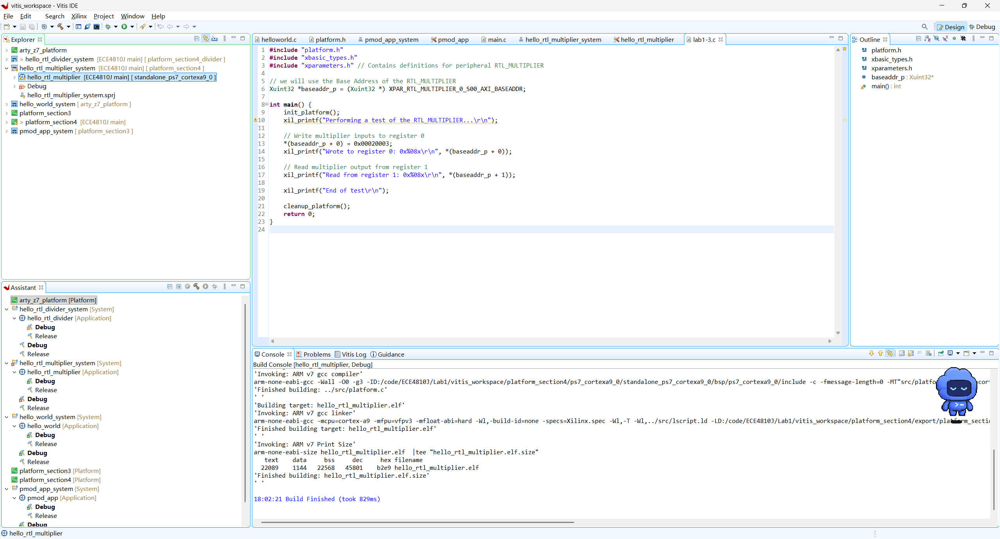

The application build console is the evidence of software compilation. System-project icons elsewhere in the IDE are separate from the successful application build shown here.

# 4.2 Multiplier Results and Resources

Figure 8. Resource utilization of the implemented multiplier system.

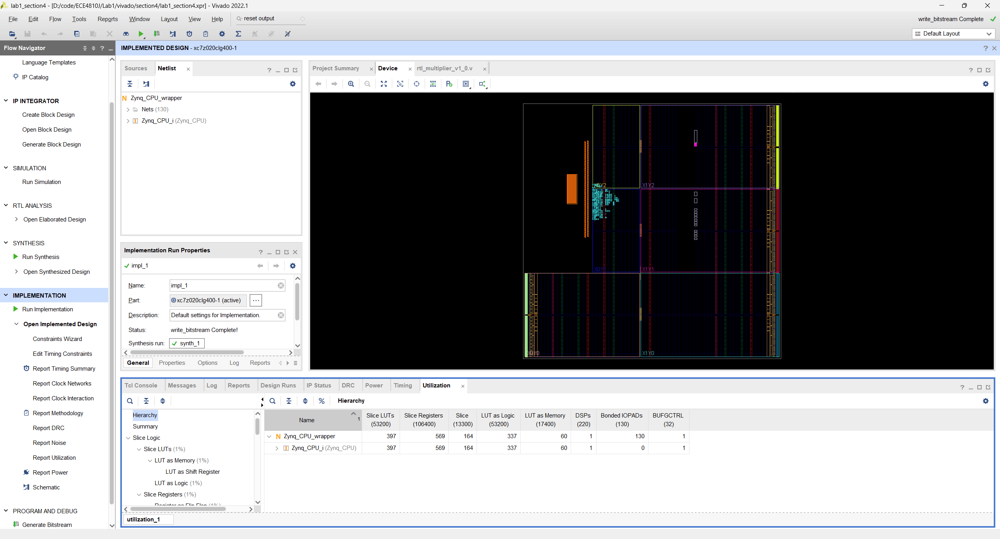

| Resource | Used | Device capacity | Utilization |

| --- | --- | --- | --- |

| Slice LUTs | 397 | 53,200 | 0.75% |

| Slice registers | 569 | 106,400 | 0.53% |

| DSP blocks | 1 | 220 | 0.45% |

The counts in Figure 8 cover the complete implemented PL system, including the AXI interface, interconnect and reset logic. They should not be interpreted as the cost of the multiplier core alone. Use of one DSP block is consistent with mapping a 16-bit multiplication into dedicated arithmetic hardware. Overall device utilization remains below 1% for the listed resources.

Figure 9. Multiplier UART test: input register 0x00020003 and result 0x00000006.

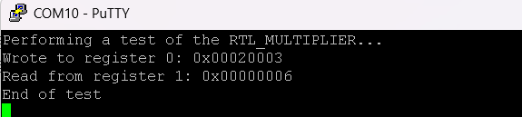

The packed input represents a = 2 and b = 3. The returned value is 6, which matches 2 * 3. This is a successful directed board test for that input pair; the captured output does not establish exhaustive correctness or a performance advantage over software.

# 4.3 AXI Divider Design

The follow-up IP computes both quotient and remainder for two unsigned 16-bit operands. It uses restoring division and a 32-bit AXI4-Lite register interface at base address 0x43C00000. The divider is integrated into a separate hardware platform so that the multiplier and divider use the same base address in different systems.

| Offset | Access | Definition |

| --- | --- | --- |

| 0x00 | Read / write | a in bits [31:16]; b in bits [15:0]; a nonzero byte-strobe write starts an operation |

| 0x04 | Read only | Unsigned quotient in bits [15:0]; upper bits are zero |

| 0x08 | Read only | Unsigned remainder in bits [15:0]; upper bits are zero |

| 0x0C | Read only | bit 0 BUSY; bit 1 DONE; bit 2 DIVIDE_BY_ZERO |

## Arithmetic and completion

For b > 0, each cycle shifts the next dividend bit into a partial remainder, compares it with b, and conditionally subtracts b while generating one quotient bit. The partial remainder is 17 bits wide to retain the shift carry. After 16 iterations, the final outputs satisfy a = quotient * b + remainder and 0 <= remainder < b. At 100 MHz, the iteration phase takes 160 ns; software-visible latency additionally includes register accesses and polling.

```verilog
shifted = {r_work[15:0], q_work[15]};
subtract = shifted >= {1'b0, divisor};
next_r = subtract ? shifted - {1'b0, divisor} : shifted;
next_q = {q_work[14:0], subtract};
```

BUSY is asserted during a normal operation. DONE is retained until a new start or reset, and the output registers retain the previous completed result while the next operation is busy. Software polls until (status & 0x3) == 0x2, then reads the quotient and remainder. A polling limit prevents an indefinite wait; the complete test application is in Appendix B.

## Interface handling and exceptional inputs

The AXI write address and write data are buffered independently, so they can arrive on different cycles. Write byte strobes preserve bytes that are not enabled; an all-zero strobe does not start an operation. Read and write responses remain stable during backpressure. A write to the input register while BUSY, a write to an output register, or an invalid address produces SLVERR. Reset aborts an unfinished operation and clears registers and pending bus state.

Division by zero is explicitly defined by this design: quotient = 0xFFFF, remainder = a and status = 0x6 (DONE and DIVIDE_BY_ZERO). This is an error indication, not a mathematical division result. The software checks this convention without executing C division or modulo with a zero divisor.

# 4.4 Divider Build and Board Tests

The divider application builds against platform_section4_divider and accesses the IP through its generated register driver. The Vitis console identifies hello_rtl_divider and reports a completed ELF build. The editor in Figure 10 still displays the multiplier starter file; the selected project and build console identify the divider application.

Figure 10. hello_rtl_divider application compilation completed successfully.

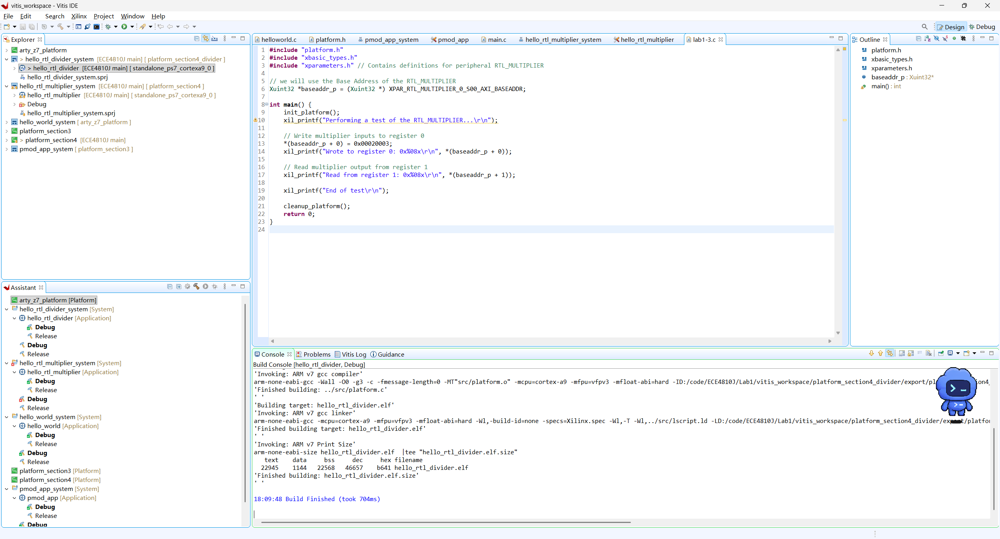

Figure 11. Divider UART output: 11 tests and zero failures, including division-by-zero cases.

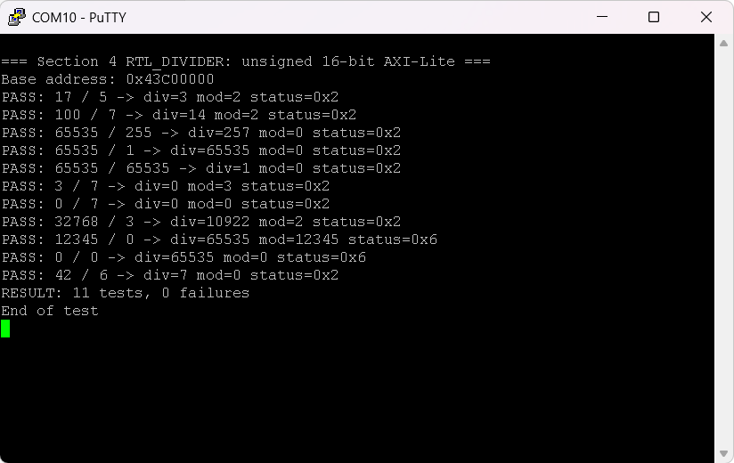

The board test covers ordinary division, exact division, maximum 16-bit operands, dividend smaller than divisor, zero dividend and zero divisor. All 11 captured cases pass; the detailed values are summarized on the next page.

# 4.5 Divider Verification and Implementation

| a | b | Quotient | Remainder | Status |

| --- | --- | --- | --- | --- |

| 17 | 5 | 3 | 2 | 0x2 |

| 100 | 7 | 14 | 2 | 0x2 |

| 65535 | 255 | 257 | 0 | 0x2 |

| 65535 | 1 | 65535 | 0 | 0x2 |

| 65535 | 65535 | 1 | 0 | 0x2 |

| 3 | 7 | 0 | 3 | 0x2 |

| 0 | 7 | 0 | 0 | 0x2 |

| 32768 | 3 | 10922 | 2 | 0x2 |

| 12345 | 0 | 65535 | 12345 | 0x6 |

| 0 | 0 | 65535 | 0 | 0x6 |

| 42 | 6 | 7 | 0 | 0x2 |

Table 1. Observed board results transcribed from Figure 11. The zero-divisor rows follow the error convention described in Section 4.3.

The XSim log records DIVIDER_SIMULATION_PASS for 272 arithmetic cases, including 256 random cases. The testbench also checks AW/W arrival skew, read/write backpressure, partial byte writes, zero strobes, read-only protection, unaligned reads, rejection while busy and reset during division. These simulation checks complement the 11 directed board tests. [4]

| Resource | Entire divider PL system | Divider IP with AXI |

| --- | --- | --- |

| LUTs | 512 (0.96% of 53,200) | 158 |

| Flip-flops | 631 (0.59% of 106,400) | 198 |

| DSP blocks | 0 | 0 |

| BRAM blocks | 0 | 0 |

Table 2. Routed resource utilization and hierarchical IP counts from the Vivado reports. The iterative shift, compare and subtract implementation uses no DSP blocks or BRAM. The complete-system counts include infrastructure outside the divider IP. [4]

| Implemented timing metric | Reported result |

| --- | --- |

| Clock period / frequency | 10.000 ns / 100.000 MHz |

| WNS / WHS / WPWS | 4.069 ns / 0.034 ns / 4.020 ns |

| TNS / THS / TPWS | 0.000 ns / 0.000 ns / 0.000 ns |

| Failing endpoints | 0 for setup, hold and pulse width |

Table 3. Routed timing summary. All user-specified timing constraints are met. The reported margins apply to the constrained implementation; they are not a measured application speedup. [4]

# 6 Tcl Exercises

The procedures below implement the three required exercises. avg accepts a list of numbers and returns a floating-point mean, rejecting an empty list. factorial accepts nonnegative integers, with factorial(0) = 1. two-fer has a default filename of main.c; its body is one line and does not use the args keyword. [1, p. 35]

```tcl
proc avg {numbers} {
    set count [llength $numbers]
    if {$count == 0} {
        error "avg requires at least one number"
    }
    set sum 0.0
    foreach number $numbers {
        set sum [expr {$sum + $number}]
    }
    return [expr {$sum / $count}]
}
proc factorial {n} {
    if {![string is integer -strict $n] || $n < 0} {
        error "factorial requires a nonnegative integer"
    }
    set result 1
    for {set i 2} {$i <= $n} {incr i} {
        set result [expr {$result * $i}]
    }
    return $result
}
proc two-fer {{name main.c}} {return "C source: $name"}
```

| Invocation | Observed output |

| --- | --- |

| avg {70 80 50 60} | 65.0 |

| avg {1 2} | 1.5 |

| factorial 3 | 6 |

| factorial 0 | 1 |

| factorial 10 | 3628800 |

| two-fer | C source: main.c |

| two-fer lab1-1.c | C source: lab1-1.c |

The code was executed with Tcl 8.6.12. All 12 checks passed, including fractional and signed averages, a one-element list, and rejection of empty averages and invalid factorial inputs. The decimal output 65.0 is numerically equal to the manual example 65. The executable source is provided separately as scripts/lab1_tcl_exercises.tcl.

# 7 Post Lab Questions

## 7.1 What is a bare metal test

A bare-metal test is a program that executes on the processor without a general-purpose operating system. Startup code initializes the execution environment, and the application accesses hardware through memory-mapped registers or board-support drivers. Our standalone Cortex-A9 applications use init_platform, GPIO or custom IP register accesses, and UART output to check basic system behavior. Successful ELF compilation alone is insufficient; the captured board output provides evidence that the application executes on the target.

## 7.2 How the Zynq PS communicates with the IP blocks

The Cortex-A9 issues memory-mapped reads and writes to addresses assigned in the Vivado design. The PS M_AXI_GP0 interface sends transactions through the AXI interconnect and protocol conversion logic to the appropriate AXI4-Lite peripheral. The GPIO drivers read button data and write LED data. For the arithmetic IPs, software writes packed operands at base + 0x00 and reads result registers. The divider also exposes a status register so software can wait for DONE before consuming results. UART output returns observations to the PC; it is separate from the PS-to-PL register interface.

## 7.3 Main features of AXI

AXI is part of Arm AMBA and provides standard interfaces between system components. AXI4 supports memory-mapped burst transfers, with up to 256 beats for incrementing bursts. AXI4-Lite uses single-beat memory-mapped transactions for control and status registers. AXI4-Stream carries a unidirectional stream without a memory address. AXI4 and AXI4-Lite separate read address (AR), read data (R), write address (AW), write data (W) and write response (B) into five channels. Each channel uses VALID/READY flow control: a transfer is accepted on a rising clock edge when both are asserted. This permits backpressure, and write address and data can arrive separately. Read and write paths can operate independently. The interconnect routes transactions by address and can adapt interface widths, clocks or protocols. In this lab, AXI4-Lite is suitable for the small GPIO and arithmetic register maps. [2]

## Conclusions

The results establish basic standalone execution and UART communication, single-button GPIO mapping, one directed multiplier board result, and correct divider outputs for all captured board cases. Divider simulation additionally exercises arithmetic and interface corner cases, while implementation reports show positive timing margins at 100 MHz. The complete GPIO photograph sequence also confirms simultaneous button operation and that all user LEDs turn off when the buttons are released. No performance comparison with a software-only implementation was measured.

## References

[1] ECE4810J Fall 2026 Lab 1 Manual, Arty Z7-20 version. Repository: Lab1/docs; requirements on pp. 17, 23, 35-36 and 38.

[2] Xilinx, AXI Reference Guide, UG761 v13.1, 7 March 2011. [Official AMD document](https://docs.amd.com/api/khub/documents/1_5L5rsU8PJY4UbkoGPAFg/content).

[3] Repository implementation: pmod_app/src/main.c; rtl_multiplier_1.0; rtl_divider_1.0; section4/lab1-divider.c and tb_rtl_divider.sv, under Lab1.

[4] Vivado and XSim records: section4_divider_utilization.txt, section4_divider_utilization_hierarchical.txt, section4_divider_timing.txt and section4_divider_simulation.txt, under Lab1/report/logs.

# Appendix A GPIO Application Code

Source: Lab1/vitis_workspace/pmod_app/src/main.c. This is the application used for the Section 3 button-to-LED tests. Blank lines are compacted for layout; executable statements are unchanged.

```c
#include "xparameters.h"
#include "xil_printf.h"
#include "xgpio.h"
#include "xstatus.h"
#include "xil_types.h"
#define BTN_ID XPAR_AXI_GPIO_BUTTONS_DEVICE_ID
#define LED_ID XPAR_AXI_GPIO_LED_DEVICE_ID
#define BTN_CHANNEL 1
#define LED_CHANNEL 1
#define BTN_MASK 0xF
int LEDOutput()
{
    XGpio led_device;
    XGpio btn_device;
    u32 data;
    int status;
    xil_printf("Entered function main\r\n");
    // Initialize LED Device
    status = XGpio_Initialize(&led_device, LED_ID);
    if (status != XST_SUCCESS)
        return XST_FAILURE;
    // Initialize Button Device
    status = XGpio_Initialize(&btn_device, BTN_ID);
    if (status != XST_SUCCESS)
        return XST_FAILURE;
    // Set Button Tristate: input = 1
    XGpio_SetDataDirection(&btn_device, BTN_CHANNEL, 0xF);
    // Set LED Tristate: output = 0
    XGpio_SetDataDirection(&led_device, LED_CHANNEL, 0x0);
    while (1)
    {
        // Read four buttons
        data = XGpio_DiscreteRead(&btn_device, BTN_CHANNEL);
        // Set corresponding LEDs
        XGpio_DiscreteWrite(
            &led_device,
            LED_CHANNEL,
            data & BTN_MASK
        );
    }
    return XST_SUCCESS;
}
int main()
{
    int Status = LEDOutput();
    if (Status != XST_SUCCESS)
    {
        xil_printf("GPIO output to the LEDs failed!\r\n");
    }
    return 0;
}
```

The 0xF mask retains only the four user-button bits. Because the full masked value is written on every loop iteration, simultaneous presses are represented by multiple set bits, and release of all buttons writes zero. No latch or software debounce is added.

# Appendix B Divider Application Code

Source: Lab1/section4/lab1-divider.c. The application compares the hardware quotient, remainder and status with expected values and prints a total failure count. Blank lines are compacted for layout.

```c
#include "platform.h"
#include "xparameters.h"
#include "rtl_divider.h"
#include "xil_printf.h"
#define DIV_BASE XPAR_RTL_DIVIDER_0_S00_AXI_BASEADDR
static int test(unsigned a, unsigned b) {
    unsigned status = 0, q, r, polls;
    unsigned expected_q = b ? a / b : 65535U;
    unsigned expected_r = b ? a % b : a;
    RTL_DIVIDER_mWriteReg(DIV_BASE, 0, (a << 16) | b);
    for (polls = 0; polls < 100000U; ++polls) {
        status = RTL_DIVIDER_mReadReg(DIV_BASE, 12);
        if ((status & (RTL_DIVIDER_BUSY | RTL_DIVIDER_DONE)) == RTL_DIVIDER_DONE)
            break;
    }
    if (polls == 100000U) {
        xil_printf("FAIL: timeout for %u / %u\r\n", a, b);
        return 1;
    }
    q = RTL_DIVIDER_mReadReg(DIV_BASE, 4);
    r = RTL_DIVIDER_mReadReg(DIV_BASE, 8);
    if (q != expected_q || r != expected_r ||
        status != (b ? RTL_DIVIDER_DONE : (RTL_DIVIDER_DONE | RTL_DIVIDER_DIVIDE_BY_ZERO))) {
        xil_printf("FAIL: %u / %u -> div=%u mod=%u status=0x%x\r\n", a, b, q, r, status);
        return 1;
    }
    xil_printf("PASS: %u / %u -> div=%u mod=%u status=0x%x\r\n", a, b, q, r, status);
    return 0;
}
int main(void) {
    static const unsigned cases[][2] = {
        {17, 5}, {100, 7}, {65535, 255}, {65535, 1}, {65535, 65535},
        {3, 7}, {0, 7}, {32768, 3}, {12345, 0}, {0, 0}, {42, 6}
    };
    unsigned i, failures = 0;
    init_platform();
    xil_printf("\r\n=== Section 4 RTL_DIVIDER: unsigned 16-bit AXI-Lite ===\r\n");
    xil_printf("Base address: 0x%08x\r\n", (unsigned)DIV_BASE);
    for (i = 0; i < sizeof(cases) / sizeof(cases[0]); ++i)
        failures += test(cases[i][0], cases[i][1]);
    xil_printf("RESULT: %u tests, %u failures\r\n", i, failures);
    xil_printf("End of test\r\n");
    cleanup_platform();
    return failures ? 1 : 0;
}
```
