# ECE4810J Lab 2 Report

Design with High Level Synthesis on Arty Z7

Digilent Arty Z7-20  |  Fall 2026  |  Group 2  |  22 October 2026

| Name | Student ID |
| --- | --- |
| Yuan Haotong | 523370910163 |
| Zhao Tong | 523370910137 |

## 1 Overview

We implemented a 16-bit HLS multiplier and two 32-bit RV32IM ALUs, integrated them with the Zynq processing system, and built an SD boot image. The final hardware uses a pipelined RTL ALU alongside the HLS ALU. Captured board output shows 100 multiplier tests and 7,509 tests for each ALU with zero failures. Jupyter also executed Python and loaded the PYNQ base overlay successfully.

The combinational RTL baseline was implemented separately for comparison. Its setup WNS was -87.707 ns at 100 MHz; the pipelined system improved this to +1.979 ns. The report separates those implementation results from the board evidence, which belongs to the pipelined image. [1, 2, 3]

## Environment

| Item | Configuration |
| --- | --- |
| Board and device | Arty Z7-20; xc7z020clg400-1 |
| Design tools | Vivado, Vitis and Vitis HLS 2022.1 on Windows |
| Hardware clock | 100 MHz; 10 ns target period |
| Bare metal software | Standalone Cortex-A9 application; UART 115200, 8N1 |
| Python environment | PYNQ Linux; browser Jupyter at 192.168.137.42:9090 |

## Report contents

| Part | Pages |
| --- | --- |
| Section 2  HLS IPs, baseline ALU and functional tests | 2-9 |
| Section 3  SD boot and interactive multiplication | 10 |
| Section 4  Python and PYNQ | 11 |
| Section 5  Pipelined RTL ALU and board verification | 12-14 |
| Section 6  Post lab questions and conclusions | 15-17 |
| References and submission evidence index | 18 |

# 2 Custom IP Blocks Using HLS

## 2.1 Multiplier design and integration

The HLS top function multiplies two 16-bit unsigned inputs and returns a 32-bit product. AXI4-Lite interface pragmas place both operands, the return value and control registers in one interface bundle. We ran C simulation, synthesis and Verilog co-simulation, exported the IP, and connected it to the same PS AXI interconnect as the RTL multiplier. [1, 4]

| HLS multiplier result | Recorded value |
| --- | --- |
| C simulation | 356 tests; 0 failures |
| C/RTL co-simulation | Pass; XSIM / Verilog |
| Synthesis target / estimated period | 10.00 ns / 3.150 ns |
| Synthesis latency / interval | 3 cycles / 4 cycles |
| HLS estimated resources | 193 LUT; 116 FF; 1 DSP; 0 BRAM |

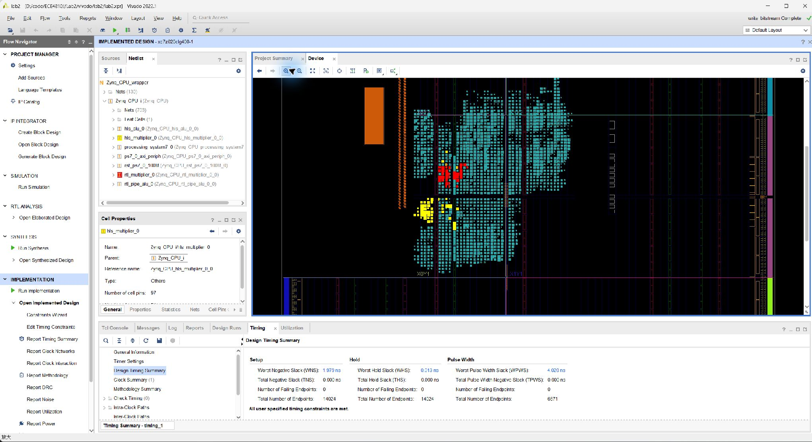

The final address map assigns RTL multiplier 0x43C00000, HLS multiplier 0x43C10000, RTL pipelined ALU 0x43C20000 and HLS ALU 0x43C30000. The RTL multiplier packs A into bits 31:16 and B into bits 15:0 of its input register; the HLS block is controlled through generated driver functions.

# 2.2 RV32IM ALU Operations

Both ALUs accept two 32-bit operands and a 5-bit selector and return a 32-bit result. The selector encoding follows the manual. Arithmetic results are 32-bit bit patterns; add, subtract and low multiplication wrap modulo 2^32. [1, p. 9]

| ID | Operation | Result interpretation |
| --- | --- | --- |
| 0 | ADD | A + B |
| 1 | SUB | A - B |
| 2 | SLT | Signed A < B, returned as 0 or 1 |
| 3 | SLTU | Unsigned A < B, returned as 0 or 1 |
| 4 | AND | Bitwise A AND B |
| 5 | OR | Bitwise A OR B |
| 6 | XOR | Bitwise A XOR B |
| 7 | SLL | Logical left shift by B[4:0] |
| 8 | SRL | Logical right shift by B[4:0] |
| 9 | SRA | Arithmetic right shift by B[4:0] |
| 10 | MUL | Low 32 product bits |
| 11 | MULH | High 32 product bits, signed x signed |
| 12 | MULHSU | High 32 product bits, signed x unsigned |
| 13 | MULHU | High 32 product bits, unsigned x unsigned |
| 14 | DIV | Signed quotient, truncated toward zero |
| 15 | DIVU | Unsigned quotient |
| 16 | REM | Signed remainder; sign follows dividend |
| 17 | REMU | Unsigned remainder |

## Exceptional operands and completeness

A zero divisor returns 0xffffffff for DIV/DIVU and the original dividend for REM/REMU. INT_MIN divided by -1 returns 0x80000000 with zero remainder. Only the low five bits of the shift amount are used, so shifting by 33 is equivalent to shifting by 1. Unused selectors return zero.

The reference RTL uses always_comb with a default assignment and complete case handling. Signed comparisons and arithmetic right shift use explicit signed casts. The HLS implementation uses unsigned arithmetic, magnitude conversion and sign correction to avoid C++ signed overflow. High signed products are derived from one unsigned product. [4]

# 2.3 HLS Functional Verification

An independent Python integer model generates 289 directed pairs from 17 edge values and 128 deterministic random pairs. Each of the 417 pairs is tested on all 18 operations, followed by three invalid-selector cases: 417 x 18 + 3 = 7,509 vectors. The HLS test bench checks each result against these stored expected values. [4]

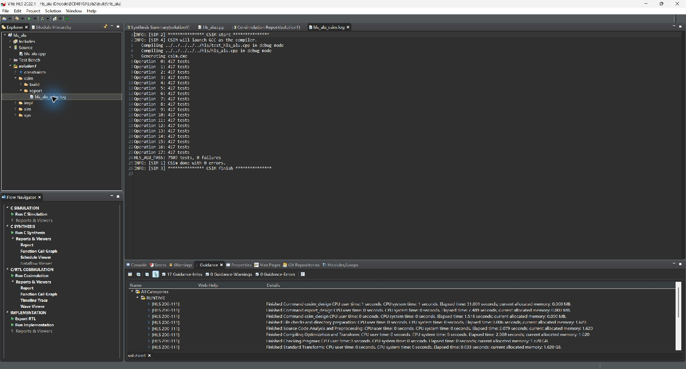

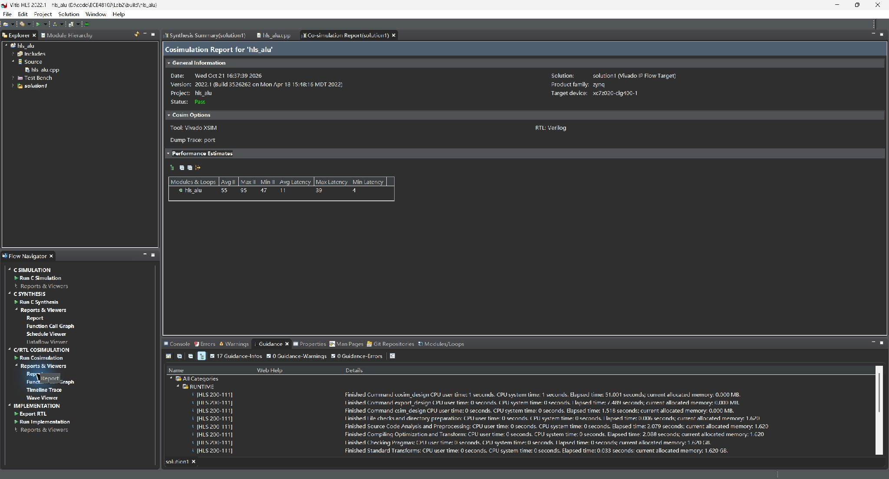

The Verilog co-simulation report records transaction latencies of 54-96 cycles and intervals of 45-87 cycles. These simulated transactions include interface activity; they should not be equated to the scheduled arithmetic latency in the synthesis report. Both checks use expected values from the independent model rather than accepting agreement between RTL and HLS alone.

# 2.4 HLS Synthesis Results

The HLS solution targets xc7z020clg400-1 with a 10 ns clock and a 2.70 ns clock uncertainty. The ALU uses an AXI4-Lite control interface. Its C/C++ operations are scheduled into multiple cycles, with separate sequential unsigned division and remainder units visible in the synthesis hierarchy. [4]

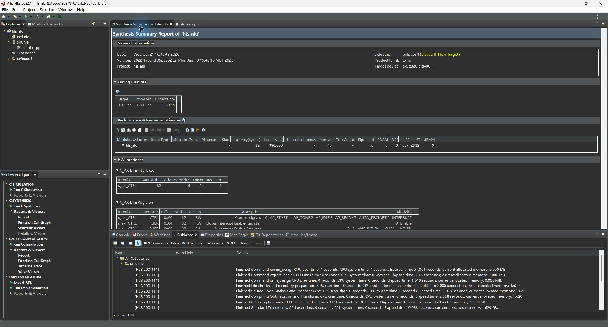

| Metric | HLS multiplier | HLS ALU |
| --- | --- | --- |
| Target period | 10.00 ns | 10.00 ns |
| Estimated period | 3.150 ns | 6.912 ns |
| Scheduled latency | 3 cycles | 4-39 cycles |
| Initiation interval | 4 cycles | 5-40 cycles |
| LUT estimate | 193 | 2,332 |
| FF estimate | 116 | 1,687 |
| DSP / BRAM estimate | 1 / 0 | 3 / 0 |

These are HLS estimates before Vivado implementation. Routed utilization differs because technology mapping, DSP inference and optimization alter the generated logic. For example, the routed HLS ALU instance uses 1,259 LUTs, 1,079 FFs and 4 DSPs. Resource comparisons later in this report use routed hierarchical data on both sides.

# 2.5 Combinational RTL Baseline

The Section 2 baseline pairs rtl_alu with hls_alu and retains both multipliers. The RTL arithmetic datapath is combinational, including division and remainder. Its wrapper exposes four AXI registers. The following views belong to the separate lab2_baseline implementation. [2]

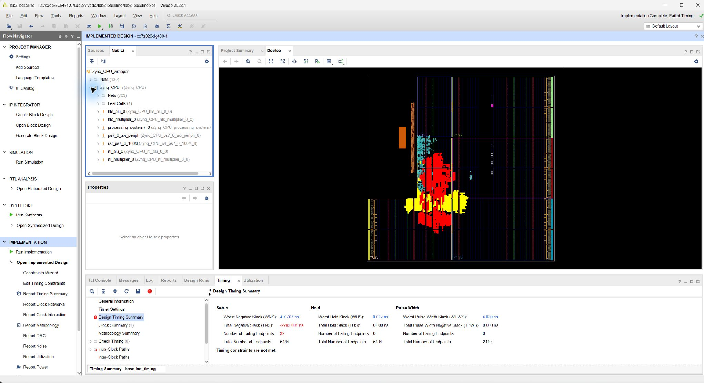

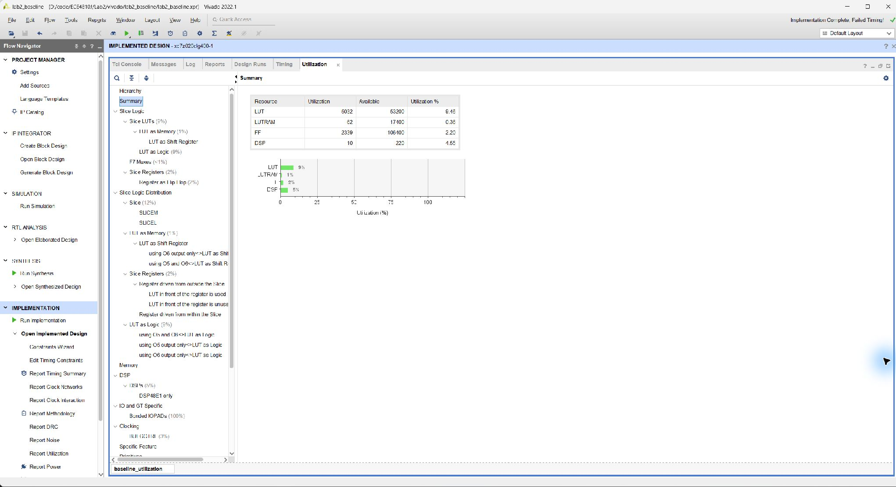

The complete baseline contains 5,032 LUTs, 2,339 FFs, 10 DSPs and no block RAM. No latches are reported. The highlighted ALU regions represent part of this system; PS interface logic, interconnect and multiplier IPs are also included in the total.

# 2.6 Baseline Timing and Resources

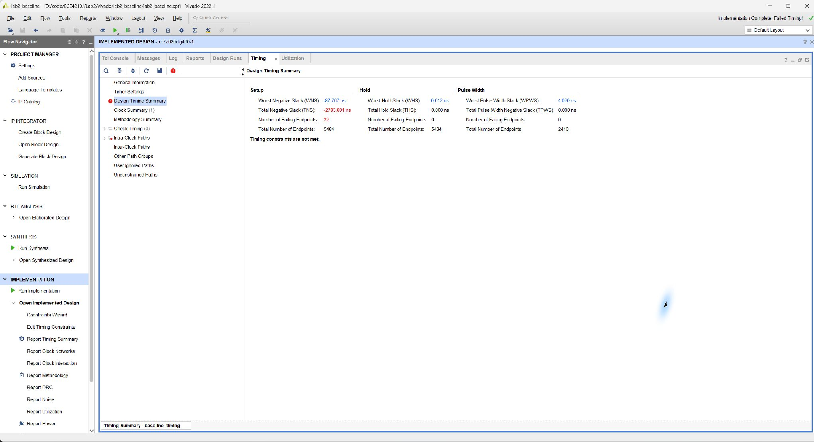

The baseline has 32 setup failing endpoints and setup TNS -2,783.881 ns. Hold timing passes with WHS +0.012 ns. The large combinational division path cannot satisfy a 10 ns period. Passing functional simulation does not establish reliable operation at this clock. No board run of this baseline is included. [2]

| Routed baseline instance | LUT | FF | DSP |
| --- | --- | --- | --- |
| RTL multiplier | 49 | 138 | 1 |
| HLS multiplier | 75 | 155 | 1 |
| Combinational RTL ALU | 3,098 | 320 | 4 |
| HLS ALU | 1,259 | 1,079 | 4 |
| Entire PL system | 5,032 | 2,339 | 10 |

The instance counts include each IP's AXI interface. Their sum is below the whole-system total because the system also contains shared interface and infrastructure logic. The HLS ALU uses fewer LUTs but more registers than the combinational RTL ALU. Its scheduled multi-cycle datapath avoids forcing all arithmetic through one combinational cycle.

# 2.7 ARM Application and AXI Access

The application initializes the HLS drivers, runs automatic self-tests and enters a UART menu. RTL access writes A at +0x00, B at +0x04 and selector/start at +0x08, then reads the result at +0x0c. The final AXI slave holds off read acceptance while computation is busy. HLS access sets operands and selector, starts the IP, polls completion with a timeout, and reads its return register. [4]

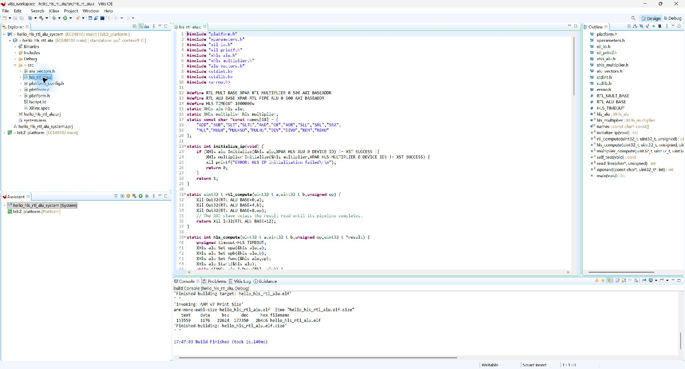

```c
Xil_Out32(RTL_ALU_BASE + 0, a);
Xil_Out32(RTL_ALU_BASE + 4, b);
Xil_Out32(RTL_ALU_BASE + 8, op);
result = Xil_In32(RTL_ALU_BASE + 12);
```

The AXI wrapper buffers write address and write data independently, supports byte strobes, keeps responses stable during backpressure, and returns SLVERR for invalid accesses or writes while busy. A zero byte-enable write does not start an operation. Reset clears pending activity. The AXI test bench passes all 7,509 vectors plus these protocol checks.

The screenshot records a Debug IDE build with -O0. The released ELF uses -O2 and the same source; its recorded build enables -Wall -Wextra -Werror. The published BOOT.BIN was checked against the restored release ELF, FSBL and bitstream. The IDE screenshot is compilation evidence; the next page supplies execution evidence. [3, 4]

# 2.8 Board Functional Results

The captured PuTTY session on 22 October 2026 contains the startup self-test and a second complete self-test after reset. Both use the final SD image with the pipelined RTL ALU. Every valid selector has 417 directed/random cases, with three additional invalid selectors in each 7,509-case ALU total. [3]

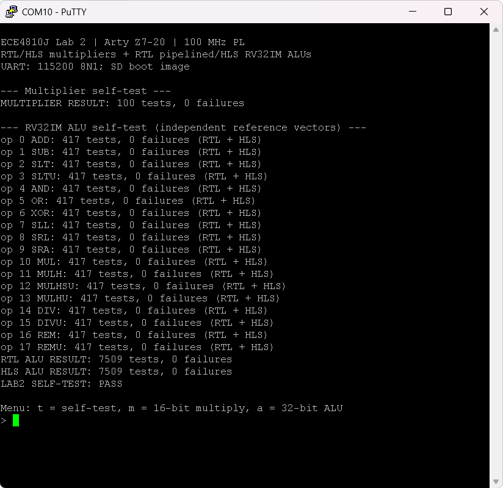

| Board check | Recorded result |
| --- | --- |
| RTL/HLS 16-bit multipliers | 100 operand pairs; 0 failures |
| RTL pipelined ALU | 7,509 tests; 0 failures |
| HLS ALU | 7,509 tests; 0 failures |
| Overall status | LAB2 SELF-TEST: PASS |

The serial captures use PuTTY rather than the Vitis Serial Terminal named in the Section 2 checklist. They record the same application results and also support the Section 3 SD-boot checks. No separate combinational-baseline board capture is claimed.

# 3 SD Boot and Interactive Operation

The boot configuration orders the Zynq FSBL, PL bitstream and ARM application. With BOOT.BIN in the FAT32 SD root and JP4 set to SD, the captured terminal shows the application banner, self-test and menu. The UART uses 115200 baud, 8 data bits, no parity, one stop bit and no flow control. [1, pp. 10-12; 3]

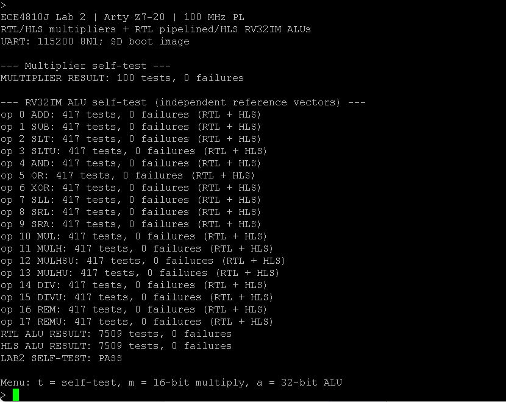

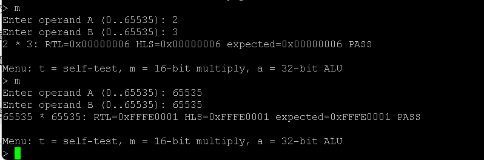

The menu command m accepts two 16-bit operands and prints both hardware results and the expected product; a selects an ALU operation; t reruns the full self-test. Repeated menu prompts show that execution continues after each transaction.

The 4,313,680-byte image passed partition-header and payload checks. Its SHA-256 is shown below; the current file matches this value. [4]

```text
9f57c42b36ea5f82667ab36efd79304cbb6
b2ceaaef4f7b6c0282296e1ca9d08
```

# 4 Python and PYNQ on Arty Z7

For the Python exercise we used the PYNQ Linux environment separately from the bare-metal BOOT.BIN. The browser reached Jupyter at 192.168.137.42:9090. The file view contains base, common, getting_started, logictools and pynq_peripherals directories; the notebook view executes Python and loads BaseOverlay. [3]

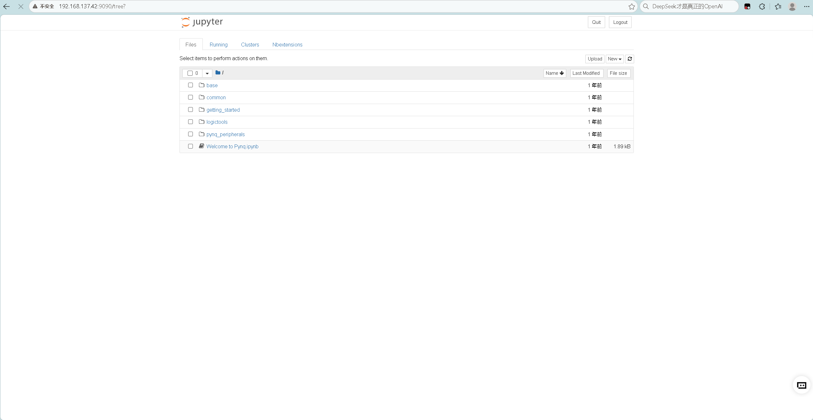

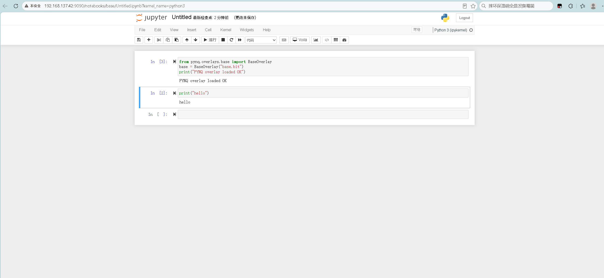

These captures establish browser access, kernel execution and successful base-overlay construction. They do not establish tests of every peripheral, a logictools run or a custom ALU overlay. The notebook uses the supplied base overlay rather than importing the bare-metal Lab 2 boot image.

# 5 RTL ALU Pipelining

## 5.1 Datapath and completion

The optional implementation replaces the combinational RTL IP with rtl_pipe_alu. Simple arithmetic, logic and shifts produce a registered result when a request is sampled. Multiplication registers the unsigned 64-bit product, then selects the low or corrected high word. Division uses 32 restoring stages between input preparation and final sign correction. [4]

| Core path | Clock edges relative to sampled start |
| --- | --- |
| ADD through SRA and invalid selector | Result and done at the sampling edge |
| MUL, MULH, MULHSU, MULHU | Product captured at start; result at the next edge |
| DIV, DIVU, REM, REMU | Input at start; 32 divide stages; result 33 cycles later |

Each restoring stage shifts one dividend bit into the partial remainder, compares it to the divisor, conditionally subtracts, and appends a quotient bit. Valid, quotient sign, remainder sign, operation choice and the divide-by-zero flag travel with the data. Reset clears valid bits so an interrupted computation cannot publish an old result.

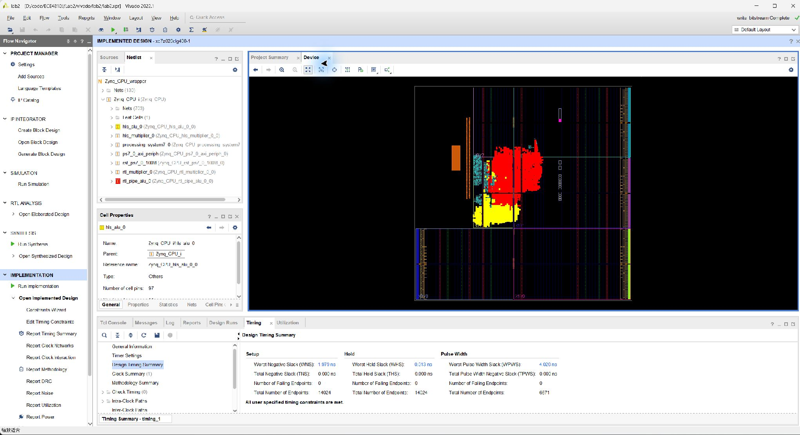

The AXI wrapper permits one outstanding arithmetic request and stalls reads while busy. Therefore, the core's pipeline structure is not evidence of one completed software transaction per cycle. AXI handshakes and processor accesses add latency to the core schedule.

# 5.2 Routed Pipeline Implementation

The final system retains the same HLS ALU, multipliers, PS configuration and 100 MHz target as the baseline. The following screenshots document the complete routed system used by the released SD image. [2]

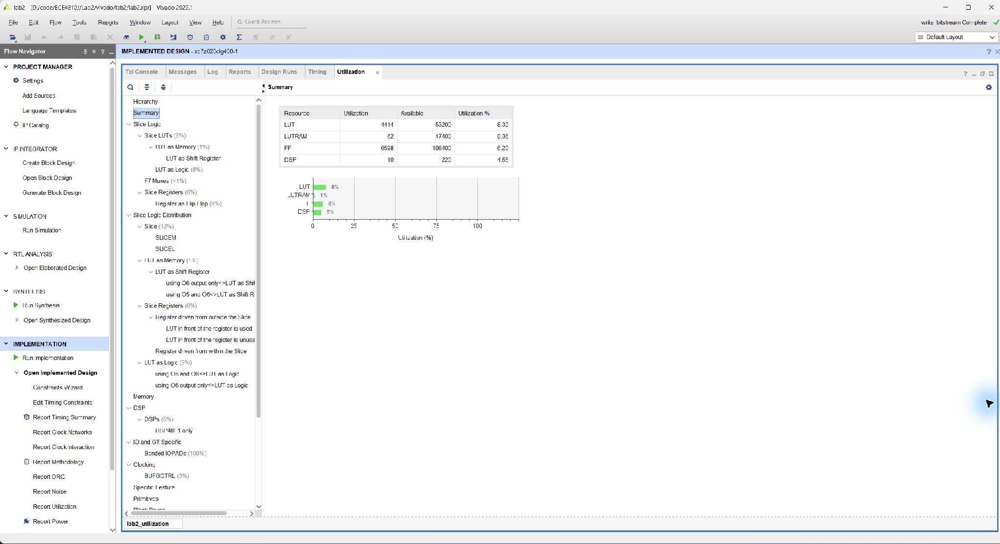

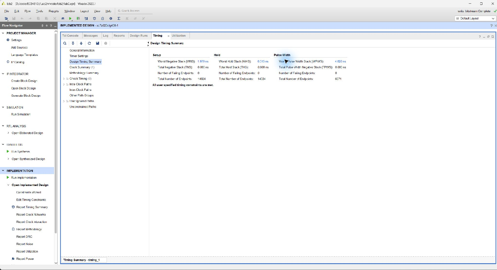

Setup, hold and pulse-width failing endpoint counts are zero. Setup TNS and hold THS are zero. The positive margins demonstrate closure for the constrained 100 MHz implementation; they do not constitute a measured application speedup or a sweep of the maximum operating frequency.

# 5.3 Pipeline Board Checks

The full board self-test already exercises all multiply, divide and remainder selectors. Additional interactive captures make the signed behavior and special operands visible. Each line reports the RTL and HLS result; the values below also agree with the independent expected results. [3]

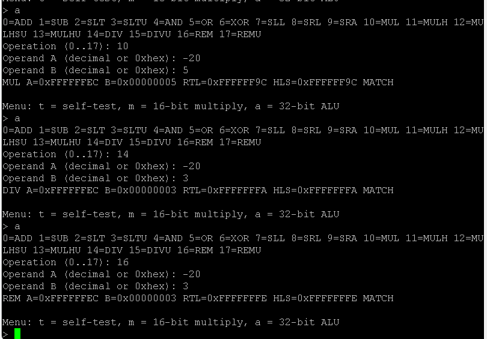

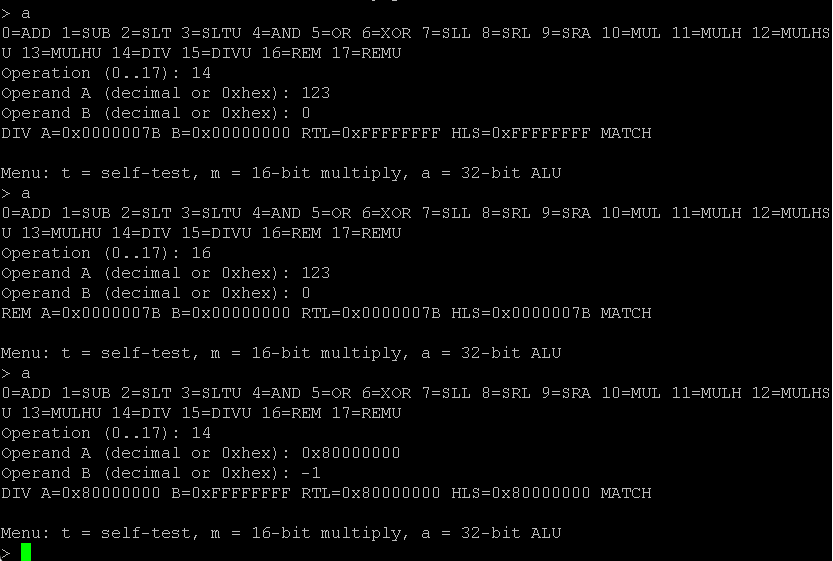

MATCH alone means that both implementations agree. Correctness here is additionally supported by the expected bit patterns and the self-test's stored reference results. RTL simulation separately passes 7,509 vectors for each architecture and reset cancellation; AXI simulation covers 7,509 vectors and protocol corner cases. [4]

# 6 Post Lab Questions

## 6.1 RTL and HLS resource utilization

The following counts come from routed hierarchical reports, including each IP's interface. The HLS instance has identical counts in the baseline and final system. These are separate from the earlier HLS synthesis estimates. [2]

| Instance | LUT | FF | DSP | BRAM |
| --- | --- | --- | --- | --- |
| RTL multiplier | 49 | 138 | 1 | 0 |
| HLS multiplier | 75 | 155 | 1 | 0 |
| Combinational RTL ALU | 3,098 | 320 | 4 | 0 |
| Pipelined RTL ALU | 2,482 | 4,579 | 4 | 0 |
| HLS ALU | 1,259 | 1,079 | 4 | 0 |

The HLS multiplier needs 26 more LUTs and 17 more FFs than the RTL multiplier, with the same DSP count. The generated AXI control interface and scheduled datapath differ from the custom RTL register interface, so this is an IP-level comparison rather than an isolated multiplication operator comparison.

The combinational RTL ALU uses 1,839 more LUTs but 759 fewer FFs than the HLS ALU. Its division/remainder network creates a long path; HLS schedules multi-cycle arithmetic and inserts state and registers. The exact area difference also depends on interface logic, sharing, mapping and optimization. The observations support an architectural explanation, not a claim that one language always produces smaller circuits.

## Effect of explicit RTL pipelining

| Complete PL system | Baseline | Pipeline |
| --- | --- | --- |
| LUT | 5,032 | 4,414 |
| FF | 2,339 | 6,598 |
| DSP / BRAM | 10 / 0 | 10 / 0 |
| Setup WNS at 100 MHz | -87.707 ns | +1.979 ns |
| Hold WHS | +0.012 ns | +0.013 ns |
| Setup failing endpoints | 32 | 0 |

Pipelining reduces total LUT use by 618 (12.3%) and adds 4,259 FFs (182.1%). At the RTL ALU instance it reduces LUTs by 616 and adds the same 4,259 FFs. Registers shorten arithmetic paths and preserve intermediate division state; the changed architecture and mapping also alter logic area. The final system meets the clock target at the cost of more sequential state and multi-cycle completion.

# 6.2 Design Choices and Overlays

## Ten sorting algorithms in one IP

We would start with HLS for a block implementing ten sorting algorithms. C/C++ makes the algorithm variants, test data and reference checks easier to express and reuse. We could verify ordering and permutation preservation in C simulation before exploring the hardware architecture. This is a development choice; the experiment does not measure sorting hardware.

We would first define bounded array sizes, supported element widths, memory interfaces and the required throughput. Loop dependencies, data-dependent iteration and memory access patterns still limit hardware parallelism. Pipelining and unrolling would be introduced only after checking resource and bandwidth constraints. RTL would be appropriate for a fixed sorting network or a critical block requiring precise cycle control. HLS is useful for comparing many algorithms, while final quality still depends on the architecture.

## What is a Jupyter notebook and why use it

A Jupyter notebook combines executable cells, explanatory text and saved output in a browser document. A kernel executes the code; the browser is its interactive front end. In this exercise the server and Python kernel run on the board's ARM processor. It lets us check imports, run short experiments and retain results alongside explanations without rebuilding a standalone application for each Python edit. The screenshot demonstrates both a Python print and an overlay load. [1, pp. 13-15; 3]

## What are overlays and their benefits

An overlay packages a programmable-logic design for reuse from Python. In the documented PYNQ interface, a bitstream configures the PL and a matching hardware handoff file describes IPs and connections; Python classes provide access to the design. Loading an overlay changes the PL hardware while Linux remains available on the PS. Hardware designers can build an accelerator once and expose a reusable interface to application developers. The bitstream must match the target board and available connections. [5]

## Which overlays are available in this environment

The captured PYNQ image exposes base and logictools notebook directories. BaseOverlay("base.bit") was successfully instantiated, so the base overlay is the one demonstrated on this Arty Z7 setup. The PYNQ-Z1 documentation, relevant to the image specified in the lab manual, also describes the logictools overlay: Boolean, pattern and finite-state-machine generation with trace capture. Its presence in documentation and the notebook directory does not prove that it was exercised on our board. [1, 3, 6, 7]

The base overlay provides drivers for board I/O and can serve as a starting point for custom overlays. Peripheral pin assignments and physical interfaces remain board dependent; using a PYNQ-Z1 image does not establish that all PYNQ-Z1 peripherals exist on Arty Z7. No additional overlay or custom Lab 2 ALU overlay was tested here. [6]

# 6.3 C and Python Development Flows

The C/C++ part and the PYNQ part operate at different stages. In Part 2, HLS translates a restricted C/C++ function into hardware. In Part 4, ordinary Python executes on the ARM under Linux and controls already-built PL hardware through the PYNQ interface. Python statements are not automatically synthesized into RTL. [1, 5]

| Aspect | Part 2 HLS and bare metal | Part 4 PYNQ |
| --- | --- | --- |
| Hardware creation | C/C++ top function becomes RTL; Vivado implements the integrated design | An existing overlay supplies PL hardware; custom hardware still needs a design flow |
| Control program | Compiled C ARM application with generated HLS drivers and MMIO | Python cells in a Linux-hosted Jupyter kernel |
| Deployment | FSBL, bitstream and application packaged in BOOT.BIN | Linux SD image plus overlay bitstream, metadata and Python drivers |
| Iteration | Hardware edits require synthesis/implementation; software edits require compile/link | Python edits run interactively; overlay edits still require a hardware rebuild |
| Timing and overhead | Explicit register transactions; deterministic core clocking | Interpreter, operating system and driver overhead around accelerator calls |
| Observed result | 18 ALU operations and SD menu tested on the final hardware | Python execution and supplied base overlay loading demonstrated |

## Conclusions

We completed HLS IP generation, AXI integration, SD-boot execution and a basic PYNQ notebook exercise. The independent test vectors and board log support all 18 RV32IM operations, including signed high multiplication, divide by zero and signed division overflow. The pipelined RTL design resolves the baseline's 100 MHz setup violation, and its routed utilization exposes the register cost of that change.

The results do not measure end-to-end acceleration over software or establish the maximum clock frequency. The combinational baseline is validated by simulation and implementation reports, while the captured hardware tests use the pipelined image. PuTTY supplies the serial evidence; the Vitis screenshot establishes a successful IDE build. PYNQ evidence is limited to the supplied base overlay and does not demonstrate a custom ALU Python driver.

# References and Evidence Index

[1] ECE4810J, Lab 2 Design with High Level Synthesis on Arty Z7 SoC Development Platform, Digilent Arty Z7-20 Version, Fall 2026. Local file: Lab2/docs/ECE4810J_FA2026_Lab_2_Manual_Arty_Z7-20.pdf. Requirements: pp. 9-17.

[2] Vivado 2022.1 routed reports: Lab2/logs/baseline_utilization_hierarchical.txt, baseline_utilization.txt, baseline_timing.txt; utilization_hierarchical.txt, utilization.txt and timing.txt. The baseline and final systems share a 100 MHz clock target.

[3] Board evidence captured 22 October 2026: Lab2/report/logs/lab2_serial.txt and the lab2_*.png images in Lab2/report/images/. The serial log includes startup, interactive arithmetic, boundary cases and repeated self-test output.

[4] Lab2 implementation and verification artifacts: hls/, rtl/, tests/, software/, scripts/, boot/manifest.json and boot/lab2.bif; logs/hls_multiplier_csim.txt, hls_multiplier_csynth.txt, hls_multiplier_cosim.txt, hls_alu_csim.txt, hls_alu_csynth.txt, hls_alu_cosim.txt, rtl_simulation.txt, axi_simulation.txt, vitis_ide_build.txt and boot_validation.txt.

[5] PYNQ documentation, Overlay. Accessed 22 October 2026.https://pynq.readthedocs.io/en/latest/pynq_libraries/overlay.html

[6] PYNQ v2.4 documentation, PYNQ-Z1 Base Overlay. Accessed 22 October 2026.https://pynq.readthedocs.io/en/v2.4/pynq_overlays/pynqz1/pynqz1_base_overlay.html

[7] PYNQ v2.5 documentation, PYNQ-Z1 Logictools Overlay. Accessed 22 October 2026.https://pynq.readthedocs.io/en/v2.5/pynq_overlays/pynqz1/pynqz1_logictools_overlay.html

## Submission evidence index

| Manual item | Report location or accompanying source |
| --- | --- |
| Section 2 multiplier implementation | Figure 1; board result on p. 9 and Figure 11 |
| HLS ALU simulation, synthesis, co-simulation | Figures 2-4; synthesis table on p. 5 |
| Baseline implementation and timing | Figures 5-7; routed resources on p. 7 |
| Vitis build and ALU board output | Figures 8-9; method qualification on p. 9 |
| SD boot and interactive multiplier | Figures 10-11 |
| PYNQ notebook including address bar | Figures 12-13 |
| Pipeline implementation and tests | Figures 14-18; comparison on p. 15 |
| Post lab questions | Section 6 on pp. 15-17 |
| Code delivered separately | rtl/rtl_alu.sv; rtl/rtl_pipe_alu.sv; hls/hls_alu.cpp; hls/hls_alu.h; hls/test_hls_alu.cpp; software/hls_rtl_alu.c; tests/alu_vectors.h; AXI/IP sources and build scripts |

The companion Markdown is editable; the PDF is the compiled group report. Code is kept as source files rather than printed in full, as permitted by the manual's separate-code deliverable. Individual peer evaluations are completed and submitted separately. All figures are existing experimental captures, with no generated substitute screenshots.
