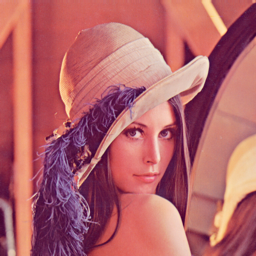
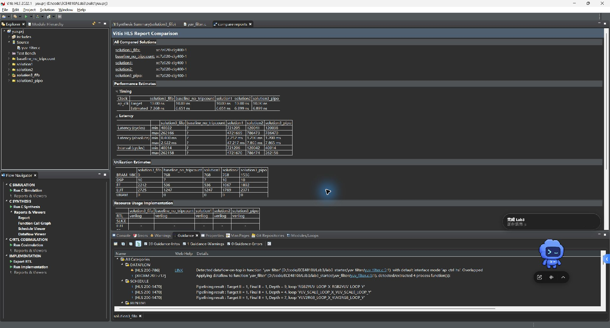
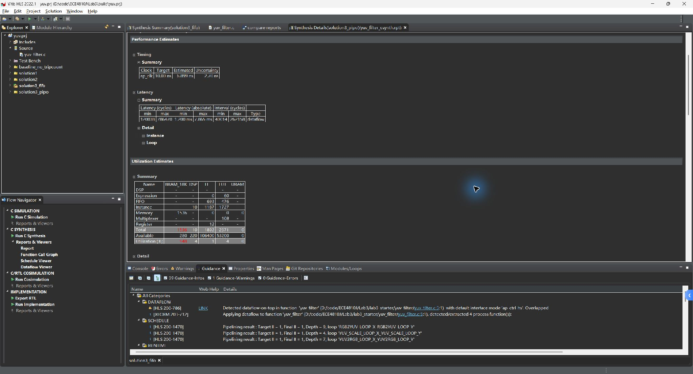
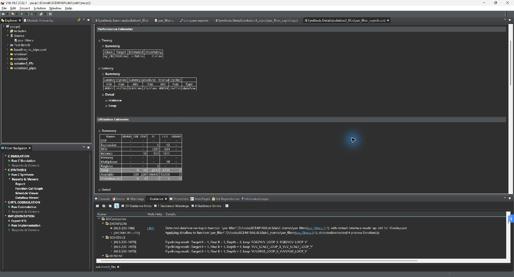
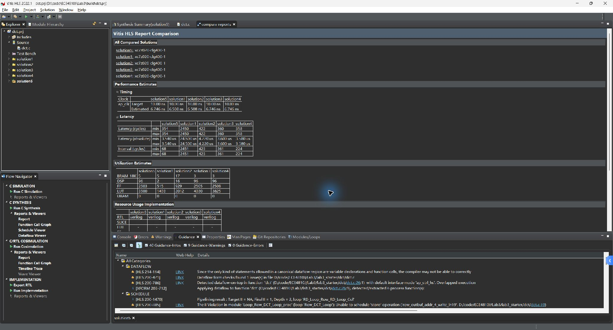
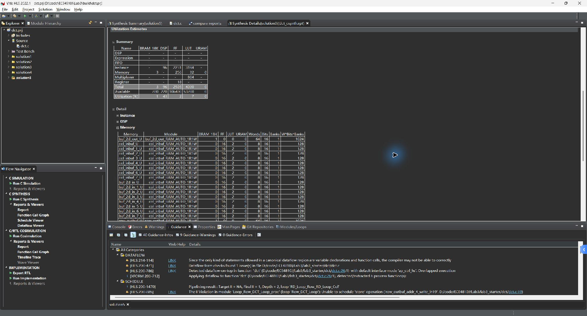

# ECE4810J - Lab 3

PYNQ Overlays and Optimizing HLS Performance through Pipelining | Arty Z7-20 | 26 October 2026

This report records completed offline implementation and measured tool results. No physical board was available. SD boot, live PYNQ outputs and board photographs remain pending. The user requested a BOOT.BIN for subsequent board testing.

| Item | Completed evidence |
| --- | --- |
| Tools and target | Vivado / Vitis / Vitis HLS 2022.1; xc7z020clg400-1; 10 ns target clock |
| Section 2 | RGB/YUV conversion; independent reference; five synthesis runs; actual HLS screenshots |
| Section 3 | Five DCT solutions; IDCT; 323-block tests; RTL cosimulation; full image recovery |
| Section 5 | Answers and board notebooks prepared; full custom Arty overlay built; board execution pending |
| Optional Section 6 | 128-tap FIR; baseline and pipelined synthesis; golden test; RTL test; host notebook |
| Board image | Matching FSBL, routed bitstream and ARM self-test application packaged and validated |

## 2.4 - Baseline function metrics

| Function | Clock ns | Worst cycles | DSP | BRAM18 | FF | LUT |
| --- | --- | --- | --- | --- | --- | --- |
| yuv_filter | 6.651 | 4721669 | 7 | 768 | 536 | 1247 |
| rgb2yuv_1 | 6.27 | 1573889 | 3 | 0 | 180 | 449 |
| yuv2rgb_1 | 6.651 | 2098177 | 4 | 0 | 151 | 317 |

TRIPCOUNT affects reporting only. Before adding it, variable-loop latencies are undefined. With the directives, worst-case yuv_filter latency is 4,721,669 cycles. Its hardware resources are unchanged: 768 BRAM18, 7 DSP, 536 FF and 1,247 LUT. yuv_scale is automatically inlined and has no separate baseline function report.

The supplied image_t contains 512 x 512 pixels, so the study uses trip counts 200..512 in each dimension. The manual uses a generic 1920 x 1280 example. These different array sizes and estimates are explicitly distinguished; no sample report values were copied.

# 2.5-2.6 - YUV optimization

| Solution | Clock ns | Max cycles | Interval | BRAM18 | DSP | FF | LUT |
| --- | --- | --- | --- | --- | --- | --- | --- |
| baseline_no_tripcount | 6.651 | undef | undef | 768 | 7 | 536 | 1247 |
| solution1 | 6.651 | 4721669 | 4721670 | 768 | 7 | 536 | 1247 |
| solution2 | 6.899 | 786473 | 786474 | 768 | 10 | 1067 | 1769 |
| solution3_fifo | 7.268 | 262166 | 262158 | 0 | 10 | 2212 | 2725 |
| solution3_pipo | 6.899 | 786470 | 262158 | 1536 | 10 | 1892 | 2371 |

solution1 explicitly disables automatic pipelining. solution2 disables inlining of all three processing stages and pipelines the innermost loops with II=1. Its worst-case latency drops from 4,721,669 to 786,473 cycles, approximately a sixfold reduction, while DSP, FF and LUT usage increases.

DATAFLOW with default ping-pong buffers permits overlap across frames. solution3_pipo has nearly the same single-frame latency as solution2, but its interval drops to 262,158 cycles. Whole-frame double buffering raises BRAM18 usage from 768 to 1,536. Both configurations exceed the device capacity of 280 BRAM18 and are synthesis studies only.

The FIFO configuration uses default_channel=fifo and fifo_depth=2. Since accesses are sequential, stages can overlap within a frame. Worst-case latency becomes 262,166 cycles and BRAM18 usage becomes zero. The estimated clock period changes to 7.268 ns. In this run FF and LUT counts increase relative to PIPO, so the manual example claim that all resource types fall is not reproduced. The measured memory reduction is the main benefit.

RGB-to-YUV uses the integer BT.601 studio-range coefficients in the manual. The inverse subtracts 16/128/128 before applying 298/409, 298/-100/-208 and 298/516 coefficients, then clips to 0..255. Conversion uses signed integer intermediates; YUV scaling preserves the starter shift-by-seven behavior for factors 0..128.

The input and output files consistently store RGB triples in raster order: row y, column x, then R/G/B. The starter image_read used the opposite nesting from image_write; this was corrected and tested against a separately generated NumPy reference.

Validation: 4,413,096 channel values pass in native C and HLS C simulation. Tests include the full 512 x 512 image, 1 x 1, 7 x 11 and 200 x 200 dimensions, unity/zero/mixed scales. YUV optimized variants were synthesized; no YUV RTL cosimulation or YUV implementation claim is made.

# 3.4-3.7 - DCT architecture study

| Solution | Clock ns | Max cycles | Interval | BRAM18 | DSP | FF | LUT |
| --- | --- | --- | --- | --- | --- | --- | --- |
| solution1 | 6.508 | 2450 | 2451 | 5 | 2 | 515 | 1493 |
| solution2 | 6.508 | 422 | 423 | 17 | 16 | 929 | 2012 |
| solution3 | 6.746 | 360 | 361 | 3 | 96 | 2505 | 4030 |
| solution4 | 6.746 | 358 | 224 | 3 | 96 | 2508 | 3825 |
| solution5 | 6.746 | 354 | 68 | 5 | 96 | 2503 | 3500 |

Section 3.4 Step 4 metrics are the solution1 row: estimated clock 6.508 ns, worst latency 2,450 cycles, 2 DSP, 5 BRAM18, 515 FF and 1,493 LUT. The innermost DCT accumulation loop is explicitly pipelined; the read/write/transpose loops are also pipelined.

solution2 removes the explicit inner-loop pipeline and lets Vitis pipeline the outer DCT loop. The inner multiply loop is unrolled, increasing coefficient access demand. Automatic coefficient ROM partitioning and additional arithmetic reduce latency to 422 cycles, using 16 DSP and 17 BRAM18.

solution3 completely partitions dimension 2 of buf_2d_in and col_inbuf. The increased read bandwidth permits more parallel operations and reduces latency to 360 cycles. Vitis additionally parallelizes row computations; the actual DSP count rises to 96. The memory detail report shows eight banks of each partitioned input buffer. Each small bank uses 16 FF and 2 LUT instead of BRAM.

solution4 adds top-level DATAFLOW. Read, dct_2d and write overlap, with interval 224 cycles and latency 358 cycles. solution5 inlines dct_2d, exposing six dataflow processes. Its interval is 68 cycles and latency is 354 cycles. More ping-pong channels raise BRAM18 from 3 to 5. Top-level latency and initiation interval describe different aspects of performance.

Verilog cosimulation passes solution1 and solution5 against 323 independently generated blocks. The test includes zero, all-255, the Lena corner, all 64 impulse positions and 256 deterministic random blocks. For solution5, the RTL report measures latency 342..451 cycles and interval 65..66 cycles. These simulation values differ from static estimates because of dataflow startup and stalls.

The full board image uses a separate compact AXI DCT/IDCT wrapper with pipelined inner loops. The five study solutions remain available for comparison; their high-throughput resource counts must not be confused with the final compact board system.

# 3.9 - Fixed-point inverse DCT

The orthonormal basis is T[k,n] = alpha(k) cos(pi (2n+1) k /16), with alpha(0)=1/sqrt(8) and alpha(k>0)=1/2. The generated coefficient table C is round(T * 2^14.5). Each forward 1D pass computes (C*x + 4096) >> 13. Thus two forward passes produce approximately eight times the orthonormal 2D DCT.

The inverse must compensate for this scale: each 1D inverse pass uses C-transpose and an arithmetic shift right by 16. This follows the manual sample, which floors each pass rather than adding a rounding bias. Applying the forward shift of 13 to the inverse would produce an incorrectly scaled image.

The implementation adds idct_1d, idct_2d and idct. The required output.dat contains the 64 recovered pixels of the Lena corner. dct.golden.dat contains forward coefficients and idct.golden.dat contains the independent inverse reference. The test fails on any mismatch in either transform.

Native C and independent NumPy models agree for all 41,344 checked transform values. Full-image C processing executes all 4,096 blocks. Compared with the original Lena image, maximum absolute error is 2, MSE is 0.57511902, and PSNR is 50.53323 dB. These are algorithm results, not measurements from a board.

# 5 - Overlays and board work

## 5.5.1 - Advantages of overlays

An overlay packages FPGA hardware as a reusable library with discoverable metadata and Python drivers. Application developers can call accelerated functions from Python, reuse IP across applications, and reconfigure hardware at runtime. Matching HWH metadata exposes IP names, addresses and registers, reducing dependence on handwritten address constants. Partial reconfiguration can change one supported region while retaining the static design.

## 5.5.2 - Software versus acceleration

Software offers rapid iteration and flexible control flow with low setup cost. Hardware is attractive for regular, parallel, compute-intensive kernels or sustained streaming workloads, where deterministic timing and throughput matter. The choice should consider end-to-end latency, data transfer and launch overhead, batch size, arithmetic precision, BRAM/DSP budget, power, engineering effort and reuse. A small scalar operation may be slower over AXI than on the CPU. The FIR notebook measures host elapsed time, including register transfers, rather than treating HLS kernel cycles as application speedup.

| Section | Prepared | Evidence still needed |
| --- | --- | --- |
| 5.1 | lab3_1.ipynb | Execute BaseOverlay discovery and LED toggle; save real outputs |
| 5.2 | lab3_2.ipynb with file checks | Arty-specific PR full/partial designs; execute both configurations; two board photographs |
| 5.3 | Procedure in ON_BOARD.md | Compatible Arty PYNQ/HelloWorld image; run original resizer notebooks; screenshots and measured timing |
| 5.4 | lab3_3.ipynb; custom Arty bit/hwh | Execute register and AddDriver checks, yielding 7, 9 and 35; save outputs |

The manual points to a PYNQ-Z1 partial-reconfiguration example. A common FPGA part does not make bitstreams board-compatible: pin constraints and PS/DDR configuration also matter. This delivery does not include Arty PR bitstreams. The prepared PR notebook stops until board-matched files are supplied. The full lab3 overlay is not a partial-reconfiguration design.

All notebooks are intentionally unexecuted. No board photos, fabricated PYNQ results or synthetic notebook outputs are supplied. BOOT.BIN runs a bare-metal test program; Jupyter requires a separate PYNQ Linux image.

# 6 - Optional 128-tap FIR

| Solution | Clock ns | Max cycles | Interval | BRAM18 | DSP | FF | LUT |
| --- | --- | --- | --- | --- | --- | --- | --- |
| baseline | 6.912 | 636 | 637 | 2 | 1 | 313 | 266 |
| pipeline | 6.912 | 134 | 135 | 2 | 1 | 385 | 332 |

The FIR implements y[n] = sum(c[k] x[n-k]) for the supplied 128 coefficients. History is initialized to zero and an explicit clear operation supports repeatable board tests. The baseline shares one multiplier and performs the shift/accumulate loop sequentially. Pipelining that loop reduces core latency from 636 to 134 cycles, while increasing FF from 313 to 385 and LUT from 266 to 332; DSP and BRAM18 remain unchanged.

All 600 samples of the provided out.gold.dat match the C implementation exactly. The AXI wrapper passes 1,024 deterministic signed input samples and a midstream history clear in C/RTL cosimulation. host_fir.ipynb loads the full Arty overlay, waits for ap_done with a timeout, validates hardware samples against NumPy convolution, saves board data and plots the input/output. Its results and plots require the board.

## SD boot deliverable and validation

| Peripheral | Base | Register layout |
| --- | --- | --- |
| dct_accel_0 | 0x43C00000 | +0x00 control; +0x10 inverse; +0x100 input; +0x200 output (32-bit words) |
| fir_accel_0 | 0x43C10000 | +0x00 control; +0x10 sample; +0x18 clear; +0x20 result |
| scalar_add | 0x43C20000 | +0x10 A; +0x18 B; +0x20 C; ap_ctrl_none |

The ARM application automatically checks 36 add vectors, 323 DCT/IDCT blocks and 1,024 FIR samples. UART commands t, d and f rerun tests, print the Lena block and dump FIR CSV respectively. DCT/FIR completion waits have a one-second timeout. The actual generated HLS register headers and XSA-derived BSP are used to compile the application.

Routed system at 100 MHz: WNS +3.387 ns, WHS +0.044 ns; all timing constraints met. Utilization is 1,650 LUT, 1,873 FF, 6 DSP and 7 BRAM36 tiles. The hardware inherits Lab 1 Arty PS/DDR/UART settings; inherited negative DDR DQS delay warnings still require physical DDR initialization testing.

BOOT.BIN size: 4,313,672 bytes. Validation checks boot and partition headers, ARM ELF load segments, the PL payload byte swap and the XSA-embedded bitstream. SHA-256: d8bbb6ef334717ea2141ec69f2e2cce13124493679193fa3f81ceb271b566f44

The application compiles with -Wall -Wextra -Werror. Build, timing, simulation, boot validation and input hashes are preserved in logs/ and boot/manifest.json. Physical SD boot remains unverified.

# Reproduction and evidence index

Run scripts/build_all.ps1 from the repository root using the installed D:/Xilinx 2022.1 tools. Python requires NumPy and Pillow. The script generates independent data, tests native implementations, builds all HLS studies and AXI IP, tests the add AXI RTL, builds Vivado hardware, generates the BSP/FSBL/application and validates the boot image. Lab 1 is required as the inherited board configuration source.

For software-only changes, use -SkipHls -SkipHardware. To repack already-built inputs, use scripts/build_boot.ps1. scripts/summarize_reports.py extracts metrics from actual Vitis XML. screenshots/ contains original GUI captures; the following appendix reproduces them without replacing values or drawing substitute tool interfaces.

Vitis 2022.1 autogenerated cosimulation of the ap_ctrl_none add IP fails because its generated testbench references ap_done. The delivered add core is instead checked by tests/test_add_axi.v, which drives the real AXI interface, separates AW/W arrival and verifies all 36 vectors. DCT and FIR use normal HLS Verilog cosimulation and pass.

Vivado can create a nonempty D:/dev/null text file on Windows; HLS make then attempts to include it. The rebuild helper preserves and clears this file only if its content matches the known [Patcher] log format. It stops for unrecognized content. The delivered synthesis and simulation evidence is retained independently of this environment workaround.

| Required output | Location |
| --- | --- |
| Section 2 comparisons and answers | report/yuv_comparison.csv; report/hls_metrics.json; screenshots/yuv_*.jpg |
| Section 3 comparisons and memory | report/dct_comparison.csv; screenshots/dct_*.jpg |
| Section 3.9 code and output | lab3_starter/dct/dct.c and output.dat |
| Recovered images | images/lena_yuv_recovered.png; images/lena_idct_recovered.png |
| Notebook sources | notebooks/lab3_1.ipynb; lab3_2.ipynb; lab3_3.ipynb; host_fir.ipynb |
| Board test image and metadata | boot/BOOT.BIN; boot/manifest.json; exported/lab3.bit and lab3.hwh |
| Real simulation evidence | logs/native_verification.txt; logs/cosim/; logs/add_axi_simulation.txt |
| Timing and boot validation | logs/timing.txt; logs/utilization.txt; logs/boot_validation.txt |

Primary references: the provided ECE4810J Fall 2026 Lab 3 Arty manual, sections 2, 3, 5 and 6; official PYNQ 2.7 Overlay Tutorial at https://pynq.readthedocs.io/en/v2.7.0/overlay_design_methodology/overlay_tutorial.html; Xilinx/PYNQ-HelloWorld repository; yunqu/partial_reconfig_example repository linked by the manual. PYNQ execution details must be checked against the installed board image.

# Appendix - HLS GUI evidence

# Appendix - HLS GUI evidence

# Appendix - HLS GUI evidence

# Appendix - HLS GUI evidence

# Appendix - HLS GUI evidence

